# AASVET 2026 Check-in System

QR-code check-in scanner for the **22nd Asian International Conference on Vocational and Technical Education (AASVET 2026)**, National Taiwan University of Science and Technology (NTUST), Taipei, Oct 28–30, 2026.

[**Live scanner**](https://tanuki3701.github.io/aasvet2026-checkin/) · [繁體中文](#繁體中文)


---

## Overview

A mobile-first web app that lets on-site staff check attendees in by scanning the QR code on their registration pass, with manual fallbacks for every situation that comes up at a registration desk. It is a single static page that talks to a Google Apps Script web app backed by Google Sheets, so there is no server to run.

Staff only ever use this page. All attendee data, email delivery and reporting live in the Google Sheet and Apps Script project, which only organizers can access.

## Screenshots

All screenshots use fictitious attendee data.

<table>
  <tr>
    <td align="center" width="25%">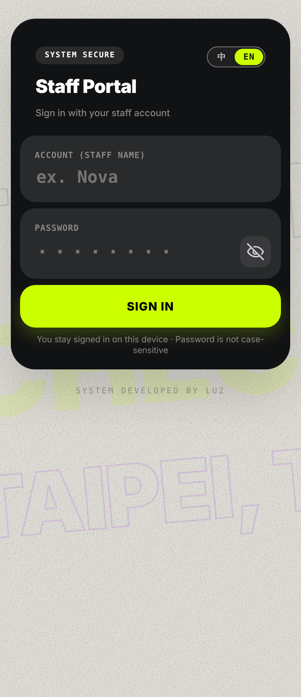<br><sub><b>Staff sign-in</b></sub></td>
    <td align="center" width="25%">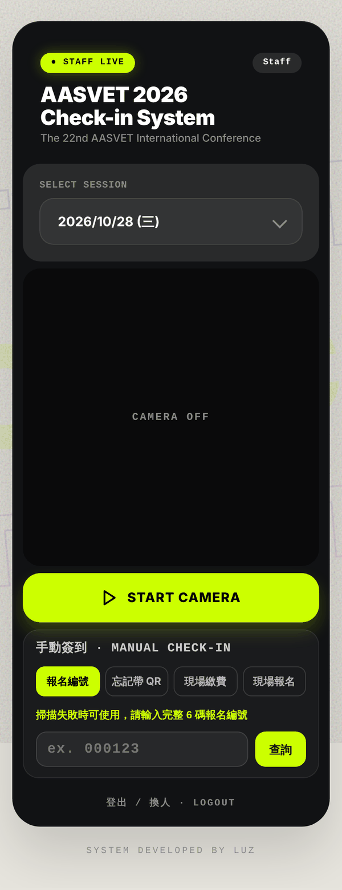<br><sub><b>Scanner</b></sub></td>
    <td align="center" width="25%">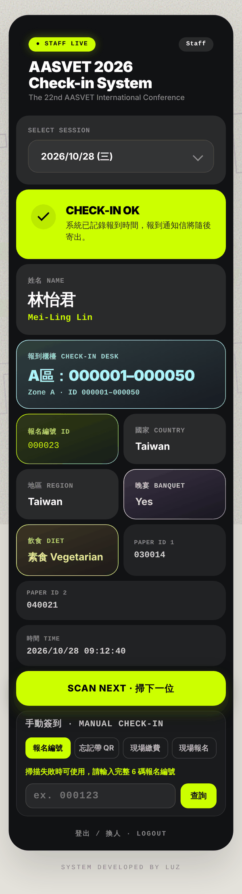<br><sub><b>Check-in success</b></sub></td>
    <td align="center" width="25%">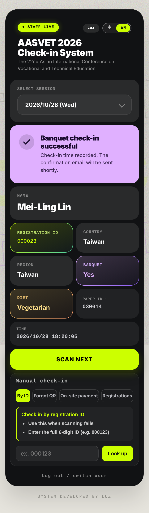<br><sub><b>Banquet check-in</b></sub></td>
  </tr>
  <tr>
    <td align="center">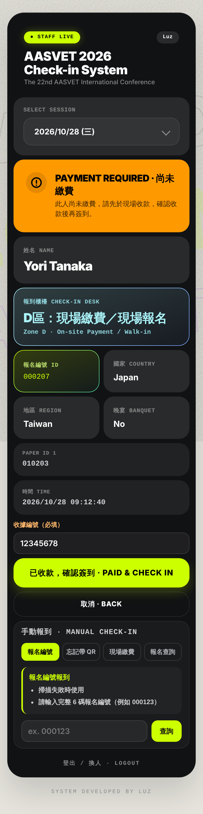<br><sub><b>Payment required</b></sub></td>
    <td align="center">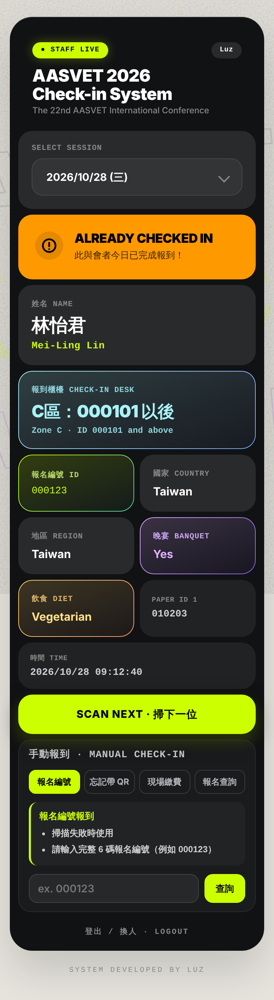<br><sub><b>Already checked in</b></sub></td>
    <td align="center">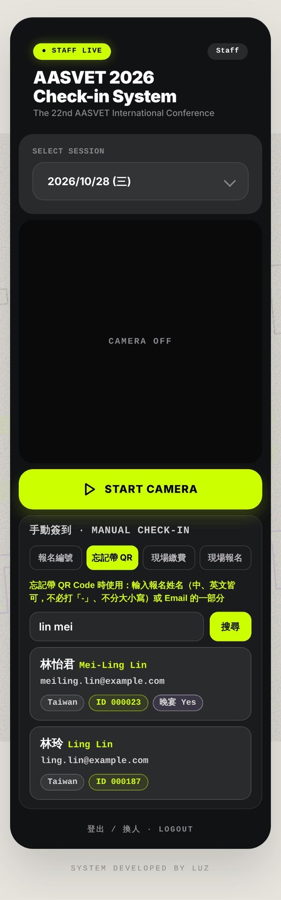<br><sub><b>Forgot-QR search</b></sub></td>
    <td align="center"></td>
  </tr>
  <tr>
    <td align="center">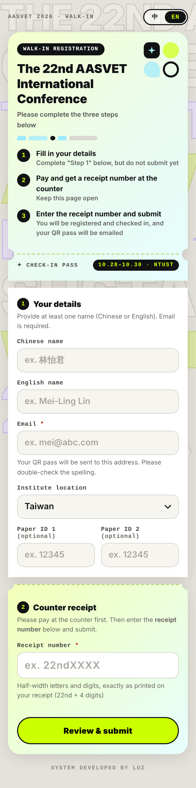<br><sub><b>Walk-in self-registration (guest)</b></sub></td>
    <td align="center">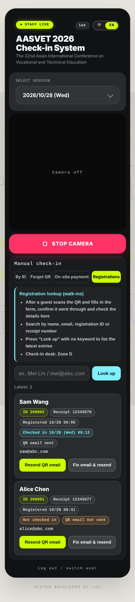<br><sub><b>Walk-in lookup (staff)</b></sub></td>
    <td align="center"></td>
    <td align="center"></td>
  </tr>
</table>

### Email previews

Attendees receive a registration pass by email with their QR code, desk assignment and venue information. Content is localized (Traditional Chinese or English) and the banquet section appears only for banquet registrants.

<table>
  <tr>
    <td align="center" width="33%">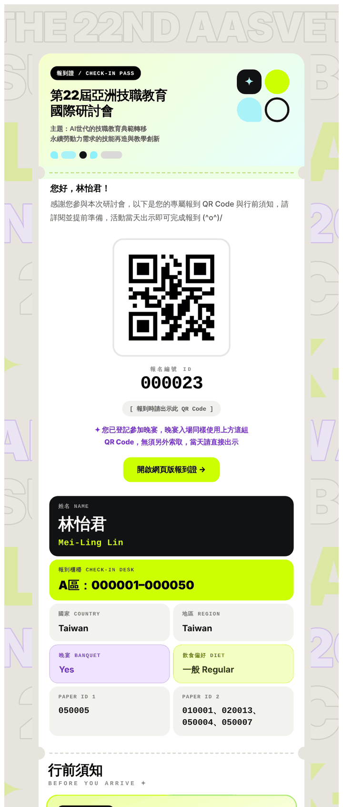<br><sub><b>Registration pass</b> · Chinese, banquet registrant</sub></td>
    <td align="center" width="33%">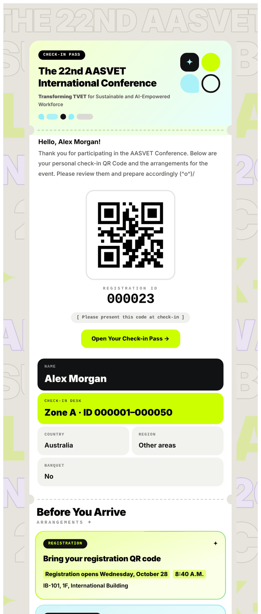<br><sub><b>Registration pass</b> · English, conference days</sub></td>
    <td align="center" width="33%">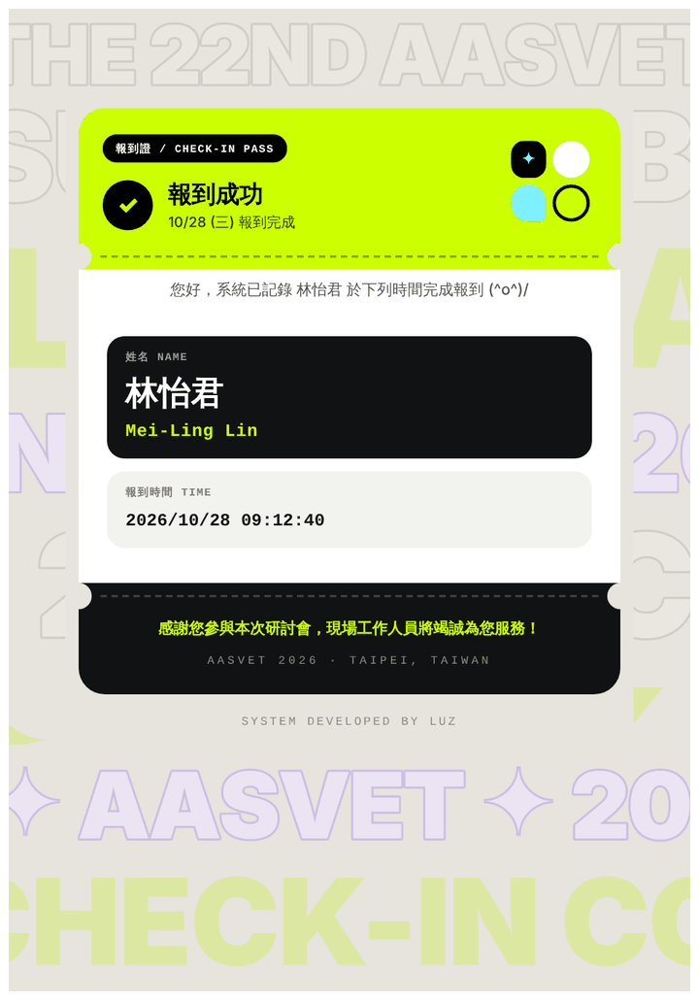<br><sub><b>Check-in confirmation</b> · sent after a successful scan</sub></td>
  </tr>
</table>

## Features

| Area | What it does |
| --- | --- |
| **QR scanning** | Live camera scan with two decoders (html5-qrcode and jsQR in a Web Worker) for reliability on iOS and Android; photo-scan fallback |
| **Session handling** | Three conference days plus the banquet; the session is auto-selected from Taipei time and can be overridden |
| **Banquet mode** | Separate banquet check-in that only admits registered banquet guests; distinct lilac UI |
| **Desk assignment** | Shows the check-in desk after each scan, assigned by registration ID range (A / B / C) |
| **Manual check-in** | Four tabs: *Registration ID*, *Forgot QR* (name or email search), *On-site payment*, *Registration lookup* (walk-ins) |
| **On-site payment** | Unpaid registrants are found by search, staff enter the counter receipt number and confirm payment, and a QR pass is emailed immediately; the receipt number is recorded in the sheets |
| **Walk-in self-registration** | Guests not on any list scan a QR code and fill in a bilingual form (`register.html`), collect a receipt number at the counter, then submit; they are registered, checked in and emailed in one step. Only a name and an email are required |
| **Walk-in lookup** | Staff can confirm a walk-in went through, review the data, and fix an email or resend the QR pass |
| **Duplicate protection** | Re-scans never create duplicate records; self-registration rejects an existing email |
| **Audit trail** | Every scan, including failures, is logged with staff name, session and outcome |

## Architecture

```
 Staff phone                    Google Apps Script              Google Sheets
┌─────────────────┐   JSON    ┌─────────────────────┐        ┌───────────────────┐
│  index.html     │ ───────▶  │  doPost() API       │ ─────▶ │ Registrations     │
│  (GitHub Pages) │ ◀───────  │  - config / search  │ ◀───── │ Check-in records  │
│  QR scanner UI  │           │  - checkin / notify │        │ Unpaid pools      │
└─────────────────┘           │  - register         │        │ Staff / scan log  │
                              │  - LockService      │        └───────────────────┘
                              │  - MailApp (QR mail)│
                              └─────────────────────┘
```

- **Frontend**: a self-contained `index.html` staff app and a public `register.html` walk-in form (no build step), served by GitHub Pages.
- **Backend**: Apps Script web app exposing a single `doPost` JSON endpoint with these actions: `config`, `search`, `checkin`, `notify`, `walkin_list`, `walkin_resend`, plus the public (no sign-in) `pub_config` and `selfreg` used by the self-registration form.
- **Storage**: Google Sheets. Paid and unpaid registrations are kept in separate pools; on-site payment and walk-in registration copy or append rows into the main sheets.
- **Concurrency**: writes run under `LockService`, so two staff members scanning at once cannot corrupt the sheet or double-record a check-in.

## Check-in desks

Desks are assigned from the 6-digit registration ID:

| Desk | Registration ID |
| --- | --- |
| A | 000001 – 000050 |
| B | 000051 – 000100 |
| C | 000101 and above |
| D | On-site payment and walk-in registration (walk-in IDs start at 260001) |

## Sheet conventions

Rows created on site are marked in the *Payment* and *Registration status* columns so they can be reconciled afterwards:

| Source | Value | Font color |
| --- | --- | --- |
| On-site payment | `現場繳費` | Orange |
| Walk-in registration | `現場報名` | Blue |

## Security model

- Access requires a staff **name and personal passcode**, verified server-side against the staff sheet. No credentials are stored in this repository or in the page source.
- The backend validates the passcode on every request and can disable a staff account instantly.
- Attendee data is never embedded in the page; it is fetched per request after authentication.
- The Apps Script endpoint URL is public by design (it also appears in attendee emails). Authentication, not URL secrecy, protects the data.

## Repository layout

```
.
├── index.html      # The staff scanner app (HTML, CSS, JS)
├── register.html   # Public walk-in self-registration form
├── assets/         # Static assets, screenshots and email previews
└── README.md
```

The Apps Script backend is maintained separately in the organizer's Google Sheet and is not part of this repository.

## Deployment

1. Push `index.html` (and `assets/`) to the `main` branch.
2. In **Settings → Pages**, set the source to `main` / root.
3. The site is published at `https://tanuki3701.github.io/aasvet2026-checkin/`.

To point the page at a different backend, change `DEFAULT_API` near the top of the script block in `index.html`.

## Using the scanner

1. Open the link in **Safari** (iPhone) or **Chrome** (Android). In-app browsers (LINE, Facebook, Instagram) often block the camera.
2. Sign in with your name and passcode once; the phone remembers it.
3. Confirm the session shown, tap **START CAMERA**, and point it at the attendee's QR code.
4. Read the result screen: green is checked in, orange means already checked in or payment required, red means not eligible.

A staff manual (PDF) is distributed to the registration team separately.

## Browser support

Current Safari (iOS 15+) and Chrome (Android) with camera permission. Desktop browsers work for manual check-in and testing.

## Credits

Developed by **Luz** for the AASVET 2026 organizing committee.

---

## 繁體中文

### 專案簡介

本系統為「第 22 屆亞洲技職教育國際研討會（AASVET 2026）」現場報到所使用的 QR Code 掃描網頁，會議於國立臺灣科技大學舉行，日期為 2026 年 10 月 28 日至 30 日。

系統採手機優先設計，為單一靜態網頁，部署於 GitHub Pages；資料儲存與信件寄送由 Google Apps Script 搭配 Google 試算表負責，無需自行維運伺服器。現場工作人員僅需使用本網頁，報名資料與後台設定僅限主辦單位存取。

### 主要功能

| 項目 | 說明 |
| --- | --- |
| QR Code 掃描 | 即時相機掃描，並提供拍照辨識作為備援 |
| 場次管理 | 涵蓋三個會議日與晚宴，依臺北時間自動切換場次，亦可手動調整 |
| 晚宴報到 | 僅限已登記晚宴者入場，採獨立介面呈現 |
| 報到櫃檯分流 | 依報名編號指派櫃檯（見下表） |
| 手動報到 | 提供「報名編號」「忘記帶 QR」「現場繳費」「報名查詢」四種方式 |
| 現場繳費 | 查詢未繳費名單，填寫收據編號並確認收款後簽到，並即時寄送 QR 報到證；收據編號會記錄在試算表 |
| 現場報名 | 名單以外之來賓掃描 QR Code 填寫中英文表單（`register.html`），至櫃檯取得收據編號後填入並送出，即完成登記、簽到並收到報到證；僅須提供姓名與 Email |
| 報名查詢 | 工作人員可確認現場報名是否成功、核對資料，並於 Email 填錯時修正後重寄 QR 報到證 |
| 重複防護 | 重複掃描不會產生重複紀錄；現場報名遇相同 Email 時會拒絕重複登記 |
| 稽核紀錄 | 每次掃描（含失敗）均記錄工作人員、場次與處理結果 |

### 報到櫃檯分流

| 櫃檯 | 報名編號 |
| --- | --- |
| A 區 | 000001 – 000050 |
| B 區 | 000051 – 000100 |
| C 區 | 000101 以後 |
| D 區 | 現場繳費、現場報名（現場報名編號自 260001 起） |

### 試算表標示規則

現場建立或變更的資料，會於「繳費情形」與「報名狀態」欄位標示，以利會後對帳：

| 來源 | 欄位內容 | 字體顏色 |
| --- | --- | --- |
| 現場繳費 | 現場繳費 | 橘色 |
| 現場報名 | 現場報名 | 藍色 |

### 系統架構

前端為工作人員用的 `index.html` 與公開的 `register.html`（免建置）；後端為 Apps Script Web App，以單一 `doPost` JSON 介面提供 `config`、`search`、`checkin`、`notify`、`walkin_list`、`walkin_resend` 等動作，另有免登入的 `pub_config`、`selfreg` 供現場報名表單使用。所有寫入作業皆經 `LockService` 鎖定，避免多人同時操作造成資料重複或錯誤。

### 資訊安全

- 登入需提供工作人員姓名與個人通行碼，由後端對照工作人員名單驗證；儲存庫與網頁原始碼中不含任何憑證。
- 後端於每次請求皆重新驗證，並可隨時停用個別帳號。
- 與會者資料不內嵌於網頁，驗證通過後才依請求取得。
- Apps Script 網址本身為公開資訊（亦會出現在與會者信件中），資料保護仰賴身分驗證，而非網址保密。

### 部署方式

1. 將 `index.html` 與 `assets/` 推送至 `main` 分支。
2. 於 **Settings → Pages** 將來源設為 `main` 分支根目錄。
3. 網站即發佈於 `https://tanuki3701.github.io/aasvet2026-checkin/`。

如需連線至其他後端，請修改 `index.html` 中的 `DEFAULT_API`。

### 使用說明

1. 以 iPhone 的 Safari 或 Android 的 Chrome 開啟網址；LINE、Facebook、Instagram 等內建瀏覽器常無法使用相機。
2. 輸入工作人員姓名與通行碼登入，裝置將記住登入狀態。
3. 確認畫面顯示之場次，點選 **START CAMERA**，將鏡頭對準與會者的 QR Code。
4. 依結果畫面處理：綠色表示報到成功；橘色表示已報到或需先收款；紅色表示不符資格。

工作人員操作手冊（PDF）另行提供予報到組。

### 開發者

由 **Luz** 為 AASVET 2026 籌備委員會開發。
